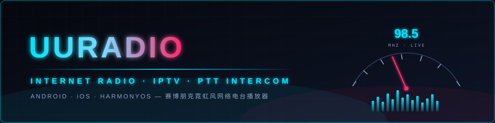
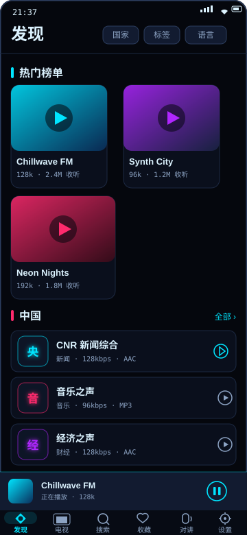
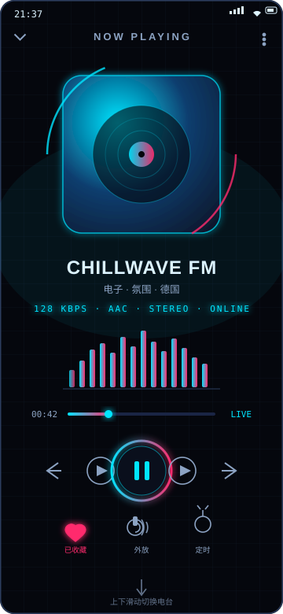
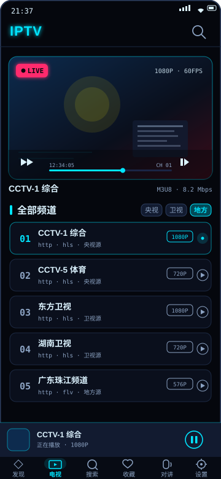
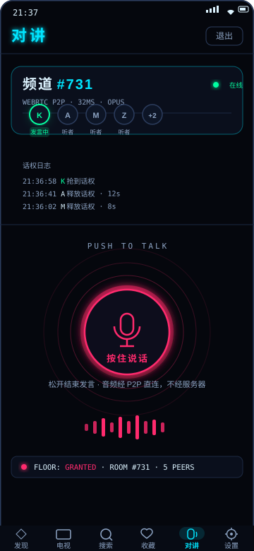
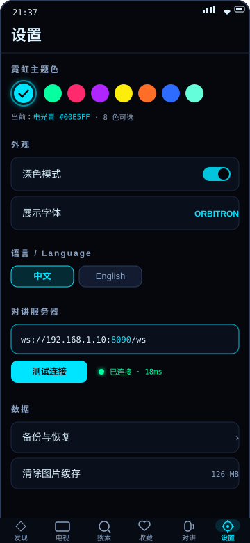
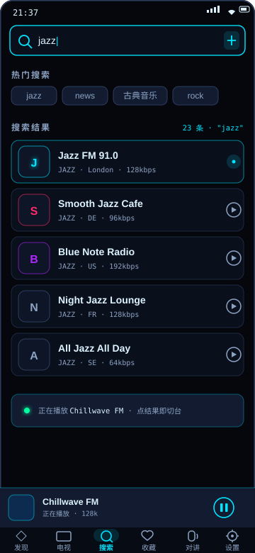
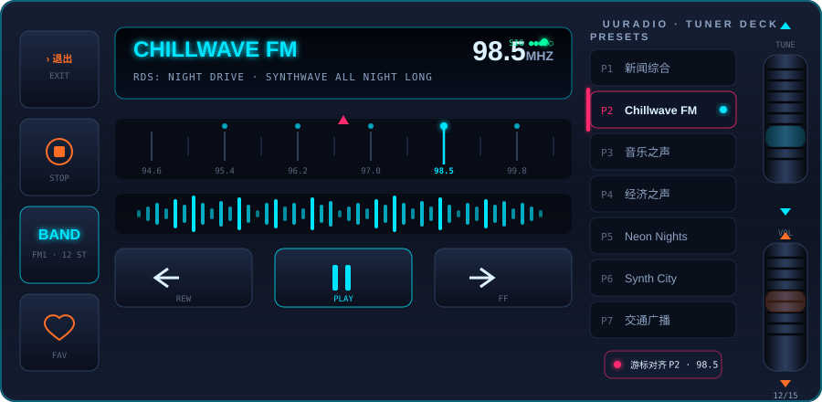
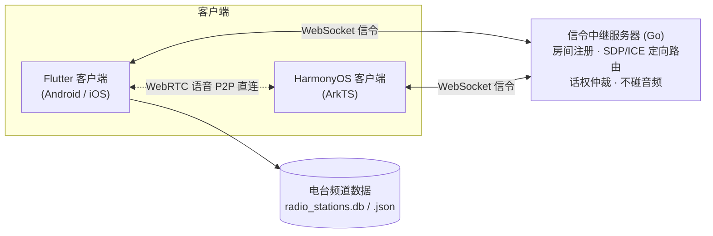

<div align="center">



**赛博朋克霓虹风的网络电台播放器 —— 电台收听 · IPTV 直播 · PTT 实时对讲**

[]()
[](frontend_flutter)
[](server/intercom)
[]()
[](LICENSE)
[]()

</div>

---

## 界面预览

<table>
  <tr>
    <td width="33%" align="center"><br/><sub><b>发现</b> · 热门榜单 / 国家电台 / 分类筛选</sub></td>
    <td width="33%" align="center"><br/><sub><b>赛博朋克舞台</b> · 频谱可视化 / 短视频式上下滑切台</sub></td>
    <td width="33%" align="center"><br/><sub><b>IPTV</b> · 频道直播 / 清晰度与信号源</sub></td>
  </tr>
  <tr>
    <td width="33%" align="center"><br/><sub><b>PTT 对讲</b> · 按住说话 / 话权仲裁 / 成员状态</sub></td>
    <td width="33%" align="center"><br/><sub><b>设置</b> · 8 色霓虹主题 / 中英双语 / 服务器配置</sub></td>
    <td width="33%" align="center"><br/><sub><b>搜索</b> · 全网电台即输即搜</sub></td>
  </tr>
</table>

**车机调谐台（横屏 MMI 模式）** —— 深色拉丝面板 + 背光实体按键 + 双滚轮，驾驶盲操习惯：

<p align="center"></p>

## 功能特性

### 电台播放
- **发现页**：热门榜单横滑卡片、按国家浏览电台、分类入口（国家 / 标签 / 语言）
- **播放器**：竖屏为赛博朋克舞台，**短视频式整页上下滑动切台**，滑到即播
- **可视化**：实时频谱（需录音权限，拒绝时自动降级）
- **调谐台（车机模式）**：横屏 MMI 金属质感面板——车载显示屏、刻度尺游标对台、RDS 文本、走带键、预设列表与双滚轮（电台飞梭 / 音量），支持 BAND 键切换电台 ↔ TV 波段
- **收藏 / 历史 / 搜索**：一键收藏、播放历史记录、全网电台搜索
- **睡眠定时器**、迷你播放条、后台播放与媒体通知（audio_service）

### IPTV
- 网络电视频道列表与直播播放（HLS / m3u8）
- 车机模式下 TV 波段转为音频轨播放（驾驶安全优先，不显示画面）

### 对讲（PTT）
- 按住说话，语音经 **WebRTC 点对点直连**（Opus 编码）
- 信令中继服务器仅负责房间注册、SDP/ICE 定向路由与话权仲裁，**不处理任何音频数据**
- 实时话权状态机与成员发言指示

### 个性化
- **8 色霓虹主题**：电光青 / 酸性绿 / 霓虹粉 / 紫脉冲 / 赛博黄 / 熔岩橙 / 极限蓝 / 薄荷辉光
- 深色 / 浅色模式，Orbitron 展示字体 + JetBrains Mono 数据字体
- **中 / 英文界面**，收藏数据备份与恢复

## 架构



## 目录结构

```
.
├── frontend_flutter/     # Flutter 客户端（Android / iOS）
│   ├── lib/core/         # 主题（赛博朋克霓虹）、路由、错误处理
│   └── lib/features/     # browse 发现、player 播放器、tv 视频、
│                         # intercom 对讲、search 搜索、favorites 收藏、
│                         # history 历史、settings 设置
├── frontend_ohos/        # HarmonyOS 客户端（ArkTS）
├── server/intercom/      # 对讲信令中继服务器（Go + WebSocket）
├── data/                 # 电台频道数据（radio_stations.db / .json）
└── docs/screenshots/     # README 界面预览图
```

## 快速开始

### 环境要求

| 组件 | 要求 |
| --- | --- |
| Flutter | ≥ 3.38（Dart ≥ 3.10） |
| Go | ≥ 1.2x |
| HarmonyOS | DevEco Studio |

### Flutter 客户端

```bash
cd frontend_flutter
flutter pub get
flutter run
```

### 对讲信令服务器

```bash
cd server/intercom
go run ./cmd/relay -addr :8090
```

客户端在设置页配置 `ws://<服务器地址>:8090/ws` 后即可加入频道对讲。

### HarmonyOS 客户端

使用 DevEco Studio 打开 `frontend_ohos` 目录，同步依赖后构建运行。

## 技术栈

| 模块 | 技术 |
| --- | --- |
| 客户端 | Flutter · Riverpod · Material 3 |
| 音频播放 | just_audio · audio_service · audio_session |
| 视频播放 | video_player（HLS 直播流） |
| 对讲 | flutter_webrtc（P2P 语音）· web_socket_channel（信令） |
| 信令服务器 | Go · WebSocket |
| 本地存储 | Hive CE · shared_preferences |
| 网络请求 | Dio |
| 国际化 | Flutter intl（中 / 英） |

## 已知限制

- `video_player` 无鸿蒙实现，HarmonyOS 端 IPTV 以音频轨方式播放
- 个别纯视频流无声、需自定义 Referer 的流会失败（车机 TV 波段）

## 许可证

本项目基于 [GPL v2](LICENSE) 许可证开源。
